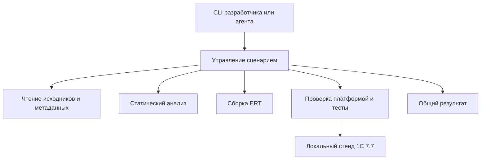

# Начальная архитектура harness77

Назначение продукта — управлять проверяемым циклом разработки для 1С 7.7. Текущая рабочая область содержит готовые части этого цикла и материалы для его дальнейшего развития. Ниже зафиксированы границы; новые программные компоненты в ходе упорядочивания не создавались.

## Четыре отдельных вида содержимого

1. **Инструмент:** чтение исходников, анализ, сборка, управление проверками и отчётами. Сейчас его заготовки находятся в `1cv77-devtools` и `77MCP`.
2. **Подключаемый проект 1С:** его исходники, контекст конфигурации и прикладные ожидания. КУДиР, ККТ и 76.АВ не определяют универсальные правила harness.
3. **Локальный стенд:** установленная платформа, выбранная тестовая база и машинные настройки. Данные хранятся в `.local`, пути передаются явно. В текущем эксперименте существующая база используется напрямую, без копирования.
4. **Исследования:** наблюдения, протоколы, прототипы и примеры. Из них в продукт переходят подтверждённые правила и небольшие тесты с указанным происхождением.

## Направление зависимостей

Это схема будущего продукта. Из её компонентов сейчас частично реализованы чтение, статический анализ и запись ERT. Общий сценарий, единый отчёт полного запуска и платформенный backend предстоит разработать.

- **Чтение:** текст и контейнеры превращаются в модули с указанием исходного файла, потока и кодировки. Адаптер к библиотеке 77MCP поставляет метаданные; запуск MCP-сервера не должен быть условием работы линтера.
- **Анализ:** принимает исходники и контекст, возвращает диагностики. Не пишет ERT, не запускает платформу и не знает каталоги конкретных прикладных проектов.
- **Сборка:** получает явные текст и шаблон ERT, выпускает отдельный артефакт. Проверка сохранности контейнера и политика кодировок развиваются отдельными задачами.
- **Платформа:** проверяет конкретный артефакт на конкретной установке 7.7 и явно выбранной тестовой базе. Способ достоверного получения результата сначала подтверждается экспериментом.
- **Сценарий и отчёты:** связывают входы, хеши, выполненные этапы и ограничения. MCP в дальнейшем вызывает те же операции, что и CLI.

## Правила дальнейшей разработки

- Один будущий Python-пакет `harness77` с внутренними модулями. Сейчас создавать пустые пакеты и заглушки не требуется.
- Корпус примеров не является исходным кодом продукта. Изменение ожидаемого результата теста требует объяснения.
- Текст модуля и шаблон ERT имеют разные роли. Для сборки используется явное направление «текст + шаблон → новый ERT»; выбор более свежего файла не заменяет это правило.
- База, профиль машины и результаты запусков не хранятся вместе с кодом инструмента.
- Успешная статика, компиляция и исполнение подтверждают разные свойства. Отсутствующий обязательный результат не считается успехом.
- Пути и каталоги конкретного пользователя не должны попадать в будущее ядро. Исправление существующих привязок выполняется при отдельном переносе кода.

## Последовательность следующих задач

Действующий порядок, статусы и критерии готовности находятся в [дорожной карте](roadmap.md). [Разбор сохранённого протокола ошибок 7.7](tasks/001-compiler-protocol.md) реализован; ближайшее задание — [эксперимент с настоящей платформой](tasks/002-platform77-experiment.md). Общий пакет не является условием его начала.

Подробные требования к дальнейшим компонентам сохранены в [ТЗ](restructuring-spec.md). Архитектура описывает их границы; очередность ведётся в дорожной карте.
