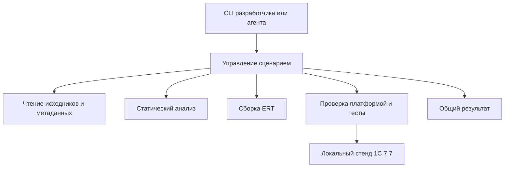

# Начальная архитектура harness77

Назначение продукта — управлять проверяемым циклом разработки для 1С 7.7. Пакет `src/harness77` объединяет существующие анализаторы и безопасные файловые операции; полный платформенный сценарий ещё предстоит связать.

## Четыре отдельных вида содержимого

1. **Инструмент:** `src/harness77`, переносимые проверки в `tests`. Исходные `1cv77-devtools` и `77MCP` сохраняют историю и прежние специализированные операции.
2. **Подключаемый проект 1С:** его исходники, контекст конфигурации и прикладные ожидания. КУДиР, ККТ и 76.АВ не определяют универсальные правила harness.
3. **Локальный стенд:** установленная платформа, выбранная тестовая база и машинные настройки. Данные хранятся в `.local`, пути передаются явно. В текущем эксперименте существующая база используется напрямую, без копирования.
4. **Исследования:** наблюдения, протоколы, прототипы и примеры. Из них в продукт переходят подтверждённые правила и небольшие тесты с указанным происхождением.

## Направление зависимостей

Это схема полного продукта. Сейчас реализованы CLI, чтение, статический анализ, импорт протоколов и проверяемая сборка ERT. Общий сценарий, единый отчёт полного запуска и платформенный backend предстоит разработать.

- **Чтение:** текст и контейнеры превращаются в модули с указанием исходного файла, потока и кодировки. Существующий CFB-код не требует внешних пакетов. Адаптер структурированных метаданных 77MCP пока исключён из поставки; сервер не является зависимостью линтера.
- **Анализ:** принимает исходники и контекст, возвращает диагностики. Не пишет ERT, не запускает платформу и не знает каталоги конкретных прикладных проектов.
- **Сборка:** `artifacts.build` получает явные текст и шаблон, использует прежний CFB writer, проверяет текст/посторонние потоки/каталог, перечитывает временный файл и публикует новый результат с хешами. Политика кодировок и файлов — в [контрактах](contracts.md).
- **Платформа:** проверяет конкретный артефакт на конкретной установке 7.7 и явно выбранной тестовой базе. Способ достоверного получения результата сначала подтверждается экспериментом.
- **Сценарий и отчёты:** связывают входы, хеши, выполненные этапы и ограничения. MCP в дальнейшем вызывает те же операции, что и CLI.

## Правила дальнейшей разработки

- Один Python-пакет `harness77` с внутренними модулями. Пустые будущие backend и заглушки не создаются.
- Корпус примеров не является исходным кодом продукта. Изменение ожидаемого результата теста требует объяснения.
- Текст модуля и шаблон ERT имеют разные роли. Для сборки используется явное направление «текст + шаблон → новый ERT»; выбор более свежего файла не заменяет это правило.
- База, профиль машины и результаты запусков не хранятся вместе с кодом инструмента.
- Успешная статика, компиляция и исполнение подтверждают разные свойства. Отсутствующий обязательный результат не считается успехом.
- Пути и каталоги конкретного пользователя не должны попадать в будущее ядро. Исправление существующих привязок выполняется при отдельном переносе кода.

## Последовательность следующих задач

Действующий порядок, статусы и критерии готовности находятся в [дорожной карте](roadmap.md). Приняты разбор протокола и ограниченный эксперимент с платформой. Пакет и сборка описаны в [этапе 3](tasks/003-package-cli.md); следующий сценарий свяжет их с исполнителем платформы.

Подробные требования к дальнейшим компонентам сохранены в [ТЗ](restructuring-spec.md). Архитектура описывает их границы; очередность ведётся в дорожной карте.
