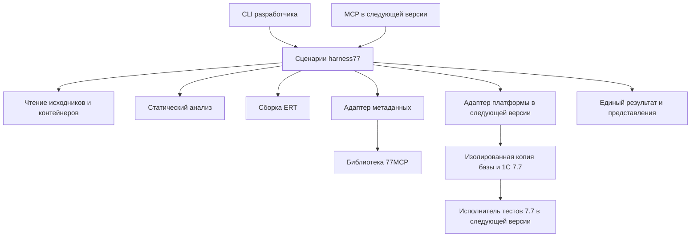

# Методологическое ТЗ на упорядочивание проекта harness77

Дата: 10 октября 2026 года. Версия: 1.2. Статус: рамочное архитектурное ТЗ; организационная раскладка выполнена, включая перенос снимка конфигурации и разделение исследования 76.АВ.

**Уточнение объёма после обсуждения:** 10 октября выполнен только начальный организационный этап — раскладка материалов, README, описание архитектуры и проверка переносов. Текущее размещение описано в [корневом README](../README.md), выполненные действия — в [журнале упорядочивания](housekeeping.md). Упаковка Python-кода, объединение Git-репозиториев и реализация harness остаются отдельными будущими задачами. Полные этапы У1–У4 ниже не объявляются выполненными.

**Цель ближайшего этапа — получить понятную, воспроизводимую основу для разработки полноценного harness для 1С 7.7.** Сохранить полезный код и накопленные свидетельства, отделить инструмент от прикладных проектов и данных, определить границы компонентов и порядок развития.

Результат выполнения этого ТЗ — единый проект с ясным назначением, установленными правилами хранения, проверяемой базовой функциональностью и последовательным планом расширения. Полный запуск 1С, исполнитель тестов и новые правила анализа относятся к следующим этапам разработки.

При первоначальной подготовке ТЗ выполнены чтение файлов, инвентаризация, сравнение контрольных сумм и доступные проверки существующего кода; тогда был создан только документ. Последующее организационное упорядочивание описано отдельно. На первом проходе программный код не менялся; при продолжении исправлены только пути в двух исследовательских скриптах и документации. Настройки платформы и содержимое базы не изменялись; платформа 1С не запускалась.

## 1 Назначение продукта и границы работ

### 1.1 Что такое harness77

Harness77 — инструментарий, который управляет воспроизводимым циклом разработки для 1С 7.7:

**исходники и контекст → статические проверки → сборка артефакта → проверка платформой → тесты на изолированной базе → отчёт с доказательствами.**

Им пользуются разработчик и программный агент. Оба обращаются к одним операциям и получают одинаковые результаты. Решение об успешности принимает код инструмента по заданным критериям; текстовый ответ агента не заменяет проверку.

Harness77 должен отвечать на вопросы:

1. Какой именно исходник и какая конфигурация проверялись?
2. Какие проверки выполнены, какие обнаружили проблему, какие остались недоступны?
3. Какой ERT получен из этого исходника и совпадает ли его содержимое с ожидаемым?
4. Какая версия платформы приняла модуль и какой охват подтверждён?
5. Какие тесты действительно исполнились и на каком исходном состоянии базы?
6. Можно ли повторить проверку и объяснить её результат?

### 1.2 Первое поддерживаемое применение

Начальный профиль: Windows, одна подтверждённая установка 1С 7.7, одна выбранная конфигурация, одна подготовленная файловая база, внешняя обработка ERT как изменяемый артефакт. MD первоначально используется для чтения модулей и метаданных.

Это ограничение первого законченного сценария, а не всей архитектуры. Работа с другими конфигурациями, полная сборка MD, SQL-базы и дополнительные способы запуска подключаются позже через определённые границы компонентов.

### 1.3 Что входит в приведение проекта в порядок

- Зафиксировать текущее состояние, включая незакоммиченные и неотслеживаемые файлы.
- Установить один корень продукта, структуру Python-пакета и правила зависимостей.
- Перенести существующие универсальные возможности без одновременного расширения их поведения.
- Отделить ККТ-релизы, рабочую базу, локальные исследования, производные файлы и эталонные примеры.
- Создать единый комплект документации и воспроизводимую команду проверки основы.
- Зафиксировать контракты будущих сборки, проверки платформой и выполнения тестов.

В этот этап не входят разработка полного парсера 7.7, новые диагностические правила, TestRunner77, автоматизация Конфигуратора, доработка КУДиР или 76.АВ, публикация ККТ-релизов и создание нового веб-интерфейса.

## 2 Состояние проекта до начального упорядочивания

Этот раздел сохраняет исходный срез обследования. Имена `base-for-test` и `kudir-experience` здесь относятся к прежнему размещению; текущие пути указаны в журнале упорядочивания.

### 2.1 Рабочая область пока не является единым репозиторием

В `C:\MyProjects\harness77` нет корневого Git-репозитория, README, описания зависимостей и единой точки входа. Внутри находятся два самостоятельных Git-репозитория:

- `1cv77-devtools`: инструменты ERT, синхронизация, ККТ-релизы и новые заготовки harness. HEAD — `15e5d0abff4232dc45aac608629d7c283a19c0d5`. Есть изменения в `README.md`, `ert_module.py`, `sync_modules.py`; линтер, его тесты и несколько документов ещё не отслеживаются Git. Один HEAD не описывает фактическое состояние этого каталога.
- `77MCP`: пакет чтения метаданных, MCP-сервер и веб-интерфейс. HEAD — `23dbcac943a750d6a58dddccf7c5dd2af5b25799`. При обследовании рабочее дерево чистое.

Следствие: нельзя начать упорядочивание с удаления папок, `git reset`, перезаписи существующего репозитория или одного массового `git add .` в корне. Сначала требуется полная фиксация состава и локальных изменений.

### 2.2 Полезная основа уже существует

**`1cv77-devtools/lint77.py`.** Частичный лексический и структурный анализ, разрешение части прямых вызовов, правила L7701–L7707, чтение текста/ERT/MD, JSON и коды возврата. Функции извлечения, анализа и CLI пока находятся в одном файле. Линтер использует `CompoundFile` из `ert_module.py` и словарь рядом с собой.

**`1cv77-devtools/ert_module.py`.** Чтение и пересборка CFB/OLE-контейнера, извлечение и замена текста модуля ERT, работа с кодировками. Это основа адаптера артефактов, но ещё не законченный безопасный сборочный процесс. `replace_text()` записывает результат, затем проверяет извлечение модуля из собранных байтов; целевая проверка остальных потоков и повторное чтение опубликованного файла должны быть явно заданы. Обёртка `push_one()` уже использует временный файл и замену назначения.

**`77MCP/src/mcp_1c77`.** Читатели OLE, парсер скобочного формата, модели и загрузчик метаданных, поиск модулей и проверка путей реквизитов. `tools.py` объединяет операции, текстовое представление ответа и глобальный загрузчик `_loader`. Поэтому его нельзя без адаптации принять за ядро многопроектного harness. `validate_query()` ищет пути регулярным выражением; это частичная проверка, а не компиляция языка запросов.

**`kudir-experience/corpus`.** Четыре случая с TXT, ERT, протоколами ошибок или журналами исполнения. Все 12 файлов, перечисленных в `manifest.json`, соответствуют сохранённым SHA-256. Это ценный регрессионный материал.

### 2.3 В инструмент попали задачи другого продукта

В `1cv77-devtools` находятся `release_ert_module.py`, `release_delphi_service.py`, каталоги модулей ATOL/Штрих и сервисов. README прежде всего описывает публикацию ККТ-релизов.

`sync_modules.py` умеет работать с каталогом проекта, но всё ещё импортирует `module_catalog.py`. Отдельные push/pull-команды вычисляют пути относительно местоположения скрипта, а `sync_modules.bat` содержит абсолютный путь на машине автора.

Это полезные инструменты своего применения. Их продуктовая принадлежность не совпадает с универсальным harness: публикация клиентских обновлений и каталог десяти ККТ-модулей не должны определять его архитектуру.

### 2.4 Основной объём занимают данные и результаты работы

На момент инвентаризации, до создания этого ТЗ:

- `base-for-test`: 17 399 файлов, 1 414,33 МиБ. Среди них 8 543 MXL, 6 241 PDF, 679 XLS, 424 ERT, 307 DBF и 306 CDX. В составе есть печатные формы, выгрузки, временные и пользовательские каталоги. Название папки само по себе не подтверждает подготовленный и обезличенный тестовый эталон.
- `.diagnostics`: 28 файлов, 2,42 МиБ. Здесь одновременно лежат исследовательские Python-скрипты, извлечённые модули, метаданные и результаты анализа.
- `kudir-experience`: 17 файлов, 0,95 МиБ. Смешаны методические выводы, исторический корпус и три вспомогательных анализатора.
- `1Cv7.MD` и `1Cv7.DD` в корне побайтно совпадают с одноимёнными файлами в `base-for-test`; совпадение подтверждено SHA-256.
- `проблема.txt` пуст: 0 байт. Скриншот относится к истории диагностики, а не к исходникам инструмента.

Размеры посчитаны как сумма размеров файлов, без оценки занятого места на диске. Файлы внутри базы по отдельности не классифицировались на удаление.

### 2.5 Существующие проверки и их ограничения

- `lint77`: **31 из 31 теста прошли**. Для успешного запуска использован доступный временный каталог; первоначальная попытка упёрлась в права на системный TEMP. Это ограничение среды запуска, не установленный дефект линтера.
- Скобочный парсер 77MCP: **14 из 14 тестов прошли**.
- Полный набор 77MCP остановился при сборе трёх тестовых модулей из-за отсутствующего `olefile`. Другие зависимости пакета также не настроены в использованном Python. Пакеты в ходе обследования не устанавливались.
- Тесты метаданных и OLE в 77MCP дополнительно ожидают `77MCP/1cv7.md`, которого сейчас нет. В них предусмотрен пропуск при отсутствии файла. Установка зависимостей сама по себе не обеспечит полноценную проверку: требуется управляемый набор входов.
- В сохранённом `.diagnostics/lint77-configuration.json` указаны 494 модуля, 1 error и 116 warning. Это исторический отчёт, а не повторная проверка всей конфигурации и не перечень 117 подтверждённых дефектов.

При повторном чтении корпуса нынешним линтером P2 дал семь L7706 на строках 423, 428, 1012, 1045, 1229, 1443, 2393. OK1 и OK2 дали ноль диагностик. P1 дал шесть L7706, но не диагностики двух классов первичных ошибок из его протокола: имя `Строка` в объявлениях и отсутствие реквизита формы. Эти пробелы должны стать задачами развития после упорядочивания.

У P1 совпадение TXT и текста ERT достигается после существующих замен символов `→` и `−`; одной нормализации перевода строк недостаточно. Следовательно, преобразования при сборке необходимо учитывать в происхождении артефакта. В остальных трёх случаях достаточно нормализации CRLF.

OK1 означает успешную компиляцию по описанию корпуса, но его журнал заканчивается `FAIL`; OK2 заканчивается `PASS`. Нельзя превращать оба случая в универсальные «положительные тесты» без указания проверяемого уровня.

### 2.6 Основной архитектурный вывод

Проблема состоит в смешении четырёх сущностей: продукта, подключаемого проекта 1С, локального стенда и исследовательских свидетельств. Простое переименование папок этого не устранит. Для каждой сущности нужны владелец, источник истины, правила хранения и граница ответственности.

## 3 Базовые архитектурные решения

Следующие решения предлагается принять как основу выполнения ТЗ и перенести в короткие ADR — записи «решение, причина, последствия, условия пересмотра».

1. **Один продукт и один основной репозиторий `harness77`.** Python-пакет с модульной структурой, без микросервисов и отдельных пакетов для каждого небольшого компонента. Существующий код переносится выборочно, с сохранением происхождения и исходных репозиториев.
2. **Python 3.11+ для управляющего кода.** Базовый анализ не требует установленной 1С, MCP-сервера или веб-сервера. Конкретную версию Python для воспроизводимого окружения зафиксировать при подготовке основы; 3.13 использовалась в этом обследовании.
3. **CLI — основная точка автоматизации.** Библиотечные операции доступны без запуска CLI. MCP и веб-интерфейс — дополнительные оболочки над теми же операциями на последующих этапах.
4. **77MCP — сначала зафиксированная внешняя зависимость за адаптером.** Не переносить весь сервер в ядро и не переписывать парсер ради новой структуры. Для пилота фиксируется обследованная ревизия; библиотечный вызов не должен требовать запущенного HTTP-сервера. Получение полной конфигурации из неё отделено от базового чтения текста модулей.
5. **Проект 1С и стенд отделены от инструмента.** Профиль проекта задаёт исходники и проверки; профиль локального стенда — платформу, базу и способ выполнения. Конкретные каталоги КУДиР и ККТ в коде ядра запрещены.
6. **Изменяемый источник истины для первой ERT — текст модуля.** Шаблон ERT поставляет форму и остальные потоки. Сборка получает явную пару «текст + шаблон» и выпускает отдельный файл. Обратный импорт из изменённой ERT является самостоятельной операцией с просмотром различий; автоматическая двусторонняя синхронизация по дате или версии не определяет источник истины.
7. **Результат обязан описывать охват.** Успешная статика, принятие модуля платформой и успешное исполнение — разные утверждения. Недоступный обязательный этап не превращается в успех.
8. **Повторяемость важнее количества функций.** Сначала один надёжный сценарий и понятные границы; затем новые возможности с собственными доказательствами и тестами.

## 4 Слои и правила зависимостей



**Контракты.** Простые структуры исходника, диагностики, артефакта, шага и запуска. Не импортируют CLI, сервер, конкретный backend или конфигурацию пользователя.

**Сценарии приложения.** Выбирают операции, передают контекст, создают идентификатор запуска и собирают результат. Не содержат разбор языка, OLE-структуры или правила бухгалтерского учёта.

**Источники.** Читают текст, ERT и модули MD; возвращают содержимое, внутренний путь и происхождение. Не запускают платформу и не решают, пройдена ли проверка проекта. Код чтения контейнера используется через один внутренний интерфейс.

**Анализ.** Принимает исходники и явный контекст, возвращает диагностики и ограничения. Не читает случайные соседние папки, не пишет ERT, не публикует релизы. Первоначально переносится существующий lint77; дальнейшее разделение лексера, контекстов и правил выполняется по мере расширения.

**Метаданные.** Предоставляют объекты, реквизиты и контексты через адаптер 77MCP. Внешние Pydantic-модели и глобальный `_loader` не становятся публичным контрактом harness. Каждый проект имеет собственный контекст загрузки; кеш связан с хешем входа.

**Сборка.** Принимает текст, шаблон и явный путь результата. Возвращает артефакт и сведения о преобразованиях. Сохранность незатронутых потоков — отдельная проверка. Текущий CFB-код и читатель `olefile` могут временно сосуществовать, но различия проверяются общими примерами и не прячутся за одинаковым словом «прочитано».

**Платформа и стенд.** В дальнейшем отвечают за возможности установленной 7.7, копию базы, процесс, тайм-ауты и получение протокола. Интерфейс описывается сейчас, реализация создаётся после технического эксперимента. Операции с данными не входят в линтер.

**Отчёты и интерфейсы.** JSON, краткий текст и позднее JUnit представляют один результат. CLI/MCP не содержат собственных копий правил. Ошибки и журналы не загрязняют машинный JSON в stdout.

Запрещены циклические зависимости, импорт `release_*`/`module_catalog`/`service_catalog` из ядра, зависимость анализа от MCP-транспорта, изменение `sys.path` ради соседнего checkout и универсальные папки `utils`/`common` без конкретной ответственности.

## 5 Целевая структура

Это ориентир для последующей технической реорганизации. Полное дерево пока не реализовано: текущая раскладка описана в корневом README, а существующие инструменты остаются в своих репозиториях.

```text
harness77/
  README.md
  pyproject.toml
  requirements-dev.lock
  .gitignore
  .gitattributes
  docs/
    restructuring-spec.md
    architecture.md
    roadmap.md
    development.md
    testing.md
    contracts.md
    migration.md
    provenance.json
    decisions/
    research/
  src/harness77/
    __init__.py
    __main__.py
    cli.py
    contracts.py
    config.py
    application.py
    sources/
    analysis/
    build/
    adapters/
      metadata_77mcp.py
    reports/
    resources/
      language77/
  tests/
    unit/
    integration/
    regression/
    fixtures/
  examples/
    minimal-ert/
  scripts/
  .local/                 локально, вне Git
    stands.toml
    baselines/
    research/
    upstream/
  .artifacts/             генерируется, вне Git
    runs/
```

- `src/harness77` содержит только реализацию продукта. `analysis` начинает с нынешнего линтера; `sources` и `build` разделяют чтение и запись без немедленного переписывания алгоритма CFB.
- `resources/language77` содержит поставляемые с пакетом данные правил. Их загрузка должна работать после установки пакета, а не только рядом с исходным скриптом.
- `tests/fixtures` содержит небольшие, разрешённые к хранению и воспроизводимые входы. Каждый бинарный пример сопровождается происхождением и хешем. Это не место для всей базы.
- `examples/minimal-ert` объясняет подключение отдельного проекта 1С. Его файлы не импортируются ядром и не являются скрытой обязательной зависимостью тестов.
- `scripts` предназначен только для обслуживания самого репозитория. Рабочая функция продукта должна быть доступна через пакет, а не существовать исключительно как скрипт в этой папке.
- `.local` — не распространяемое локальное состояние: сведения о стенде, эталоны, оригиналы исследований, при необходимости исходные checkout. Крупные базы могут храниться вне корня; локальный профиль ссылается на их абсолютный путь.
- `.artifacts/runs/<run-id>` содержит временные файлы, артефакты и отчёт одного запуска. Они не становятся входами следующего запуска автоматически.

Папки `runtime`, `runner77`, `interfaces/mcp` и дополнительные backend добавляются только на этапе их реального появления. Пустые каркасы «на будущее», заглушки с фиктивным успехом и универсальный механизм плагинов для первой основы не требуются.

## 6 Решения по существующим папкам и файлам

### 6.1 `1cv77-devtools`

Перенести в продукт полезную реализацию `lint77.py`, `lint77-builtins.json`, `ert_module.py` и тесты. На первом переносе сохранить диагностические коды и наблюдаемое поведение. Разделение файлов и смену алгоритмов выполнять разными изменениями.

`push_txt_to_ert.py` и `pull_ert_to_txt.py` использовать как источник существующих операций явного импорта и сборки. Их пути должны задаваться параметрами проекта. `sync_modules.py` сохранить в исходном devtools до отдельного выделения универсальной части; целевое ядро не должно зависеть от каталога ККТ.

`release_ert_module.py`, `release_delphi_service.py`, `module_catalog.py`, `service_catalog.py` оставить в самостоятельном devtools для ККТ. В продукт harness77 их не копировать. Функция выпуска дистрибутива harness, если появится, будет отдельной задачей.

Существующие README, `readme.txt`, BAT-файлы и инструкции синхронизации сохраняются вместе с исходным devtools. В новый README переносится только информация о harness. Персональные BAT-файлы не становятся стандартной точкой входа.

`HARNESS77-PLAN.md` использовать как источник дорожной карты. Его содержательные ограничения и критерии сохранить; прежнюю очередность и оценки не переносить автоматически на этап упорядочивания. `PROMPTPILOT-START.md` и `PROMPTPILOT-PROMPT.txt` становятся историческими материалами: они начинают работу с эксперимента платформы, тогда как ближайшая задача теперь — подготовка архитектурной основы.

### 6.2 `77MCP`

Сохранить исходный репозиторий и точную ревизию как upstream. После фиксации состояния убрать checkout из обязательной структуры продукта: он может жить в `.local/upstream/77MCP` или в отдельном каталоге репозиториев. Установка продукта не должна рассчитывать на его присутствие рядом.

Зависимость адаптера фиксируется на конкретной ревизии и подключается отдельной группой зависимостей, например `metadata`. MCP/HTTP-сервер не требуется для базового линтера. В пилоте допустим состав зависимостей upstream-пакета; выделение более лёгкой библиотеки является самостоятельной последующей оптимизацией.

Перед включением чужих исходников непосредственно в продукт фиксируются происхождение и применимые условия использования. В локальном README 77MCP заявлена MIT, но отдельного файла LICENSE в обследованном корне нет; не подменять этим утверждением проверку конкретного импортируемого состава.

Учитывать расхождение документации и кода: README сообщает порт 8080, точка входа и compose используют 8099. Это пример сведений, которые нельзя копировать в новую инструкцию без сверки.

### 6.3 `base-for-test`

Классифицировать как локальную исходную базу для подготовки стенда. Сохранить целиком до отдельной работы с данными. Вынести из версионируемого дерева в локальное хранилище; записать в профиль стенда путь, назначение и происхождение.

Не очищать из неё `ExtForms`, DBF, CDX, пользовательские каталоги и другие файлы по одному лишь имени или расширению. Из состава базы позже подготовить минимальный эталон с согласованными данными и отключёнными внешними действиями. Копирование/архивирование базы выполнять только в подтверждённом согласованном состоянии.

Для дальнейшего runtime нужны три разных места: неизменяемый эталон, рабочая копия конкретного запуска и отчёты. Текущая `base-for-test` не получает эти роли автоматически.

### 6.4 Корневые `1Cv7.MD` и `1Cv7.DD`

Классифицировать как подтверждённые дубли. Выбрать именованный снимок конфигурации с хешем, назначением и связью с профилем проекта. MD и DD сохранять совместно там, где они представляют одну конфигурацию; не выдавать эти два файла за полную тестовую базу.

Корневые копии становятся кандидатами на удаление лишь после перенастройки всех ссылок, включая `.diagnostics/inspect_76av.py`, старые примеры CLI и инструкции. Проверка: сценарии анализа используют явно заданный снимок, а его хеш соответствует выбранному источнику. До этого дубли остаются на месте.

### 6.5 `.diagnostics`

Разделить содержимое по назначению:

- `inspect_76av.py`, `read_76av_context.py` — локальные исследовательские скрипты; сохранить в исследовании 76.АВ вместе с условиями запуска. Если позднее выделяется универсальное извлечение, оно переносится в продукт отдельной задачей.
- `metadata.txt`, `modules/`, `lint77-*.json` — производные материалы с привязкой к исходному хешу. Исторические результаты сохранить в локальном архиве исследования; новые результаты писать в `.artifacts/runs`.
- В документацию перенести выводы и ссылки на свидетельства, а не весь выгруженный код конфигурации.

### 6.6 `kudir-experience`

Методические выводы из README перенести в `docs/research/kudir.md`, сохранив разграничение подтверждённых наблюдений и гипотез. Три `session_*.py` оставить как исторические прототипы. Не объявлять их вторым производственным линтером и не запускать автоматически в основном наборе.

Корпус P1/P2/OK1/OK2 сохранить с исходными хешами и точными ожиданиями. Оригинальные журналы могут содержать данные прикладной базы и остаются в локальном архиве до проверки состава. Для репозитория выделить минимальные примеры или подготовить очищенные копии с новыми хешами и ссылкой на происхождение. Редактировать оригинал и одновременно сохранять старый хеш запрещено.

В манифесте каждого регрессионного случая раздельно задать ожидаемую статику, результат компиляции, результат исполнения и способ получения свидетельства. Слово `ok` в имени каталога не является ожиданием для всех уровней.

### 6.7 Прочие файлы

Пустой `проблема.txt` можно удалить на этапе согласованной очистки после включения в реестр. Скриншот сохранить как свидетельство в архиве соответствующего исследования; в публичный корпус включать только после проверки содержимого. Кеши `__pycache__`, `.pytest_cache` и сборочные каталоги исключаются из Git и удаляются как воспроизводимые результаты.

**Ни один файл не удаляется только потому, что кажется лишним.** У каждого удаления должны быть классификация, причина, проверенный сохранённый экземпляр для невоспроизводимых данных и отсутствие действующих ссылок.

## 7 Правила хранения и источников истины

1. **Код инструмента:** Git основного проекта; обязательны тесты и документация публичного поведения.
2. **Код подключаемого проекта 1С:** собственное хранилище этого проекта. Harness получает явные пути; не присваивает себе владение всей базой.
3. **Контейнеры и снимки:** имя, назначение, SHA-256, источник и профиль. Одинаковое имя файла не доказывает одинаковое содержимое.
4. **Результаты:** отдельный каталог запуска с `run-id`; они не редактируются для получения успешного статуса.
5. **Знания о 7.7:** версионируемый каталог с происхождением, областью применимости и степенью подтверждения. Имена из справочника не означают доступность каждого метода в каждом контексте.
6. **Локальные сведения:** пути к платформе, базам и внешним компонентам — в `.local/stands.toml`; пароли и ключи не попадают в профиль проекта и отчёт.

Принять для нового Python-кода и документации UTF-8 без BOM и LF. Для текстов 7.7 импортировать известные существующие кодировки без потерь; способ декодирования фиксировать. Внутри ERT использовать явно заданное преобразование в CP1251/CRLF. Текущие автоматические замены символов сначала документировать как legacy-поведение. Переход к строгому режиму сборки вынести в отдельное изменение с тестами: непредставимый символ по умолчанию останавливает сборку; разрешённая пользователем нормализация оставляет отчёт о заменах.

Не игнорировать все `*.md`: на Windows это может одновременно скрыть Markdown-документацию и бинарную конфигурацию `1Cv7.MD`. Бинарные входы размещать по выделенным путям, учитывать тип/сигнатуру файла и применять точечные правила Git.

## 8 Минимальные контракты

Контракты ниже — требования к будущей реализации. Они не означают, что соответствующие команды уже существуют.

### 8.1 Профиль проекта

Предлагается `harness77.toml`: TOML читается стандартными средствами выбранной базы Python 3.11+. Ранее предложенный `project.yaml` остаётся историческим вариантом до фиксации ADR. Поддерживать два формата в первой основе не требуется.

Обязательные сведения: версия схемы, идентификатор проекта, явный список/маски исходников, исключения, вид и кодировка модуля, MD-контекст при необходимости, пары текст/шаблон ERT, профиль правил, обязательные этапы и наборы тестов. Относительные пути разрешаются от каталога профиля, а не от текущего рабочего каталога оболочки.

Профиль локального стенда содержит имя стенда, путь и идентификацию платформы, backend, расположение эталона и рабочих копий, ограничения времени и параллельности. Ссылка на стенд в проекте не включает машинные пути.

### 8.2 Общие сущности

- **SourceUnit:** идентификатор, путь артефакта, внутренний путь потока, вид модуля, текст, кодировка, хеш исходных байтов и связь строк с первоисточником.
- **Diagnostic:** правило, уровень, сообщение, исходник, строка/колонка, область проверки, основание/ограничение. Неизвестность не объявляется подтверждённой ошибкой только из-за отсутствия записи в словаре.
- **Artifact:** тип, путь, SHA-256 результата, входные хеши, версия сборочного адаптера, перечень преобразований и результат обратной проверки.
- **StepResult:** идентификатор этапа, обязательность, состояние, охват, диагностики, ссылки на свидетельства и причина неполноты.
- **RunResult:** версия схемы и инструмента, идентификатор запуска, режим, профиль проекта и его хеш, входы, артефакты, окружение, результаты этапов и итоговый код.

Пути внутри переносимого отчёта по возможности относительные; полные локальные пути нужны только там, где помогают диагностике и допустимы для адресата. Внешние библиотечные объекты не записываются в JSON напрямую.

### 8.3 Статусы и режимы

Этап получает `passed`, `failed`, `blocked` или `skipped`. `blocked` означает отсутствие необходимого результата, например недоступную платформу или неполный обязательный охват. `skipped` допустим для этапа, не требуемого выбранным режимом.

Коды завершения: `0` — выполнены и пройдены все обязательные этапы выбранного режима; `1` — подтверждённая блокирующая диагностика или провал теста; `2` — ошибка входов, среды, исполнения либо неполный обязательный результат. При одновременном дефекте и инфраструктурном сбое приоритет у `2`, оба основания сохраняются.

`fast` подтверждает только заданные статические проверки. `full` требует сборки, проверки платформой и выполнения зарегистрированных тестов. Пока эти возможности отсутствуют, `full` не может возвращать успешный результат. Пустой, старый, незавершённый отчёт и ноль выполненных обязательных тестов не считаются успехом.

### 8.4 Направление развития CLI

В архитектурной основе допускаются тонкие команды к существующим возможностям: извлечение, lint, сборка копии ERT; метаданные — при установленной дополнительной зависимости. Конкретные имена и параметры фиксируются в `docs/contracts.md` перед переносом интерфейса. Существующие самостоятельные скрипты остаются рабочими в исходном devtools.

Дальнейший интерфейс: `doctor`, `platform-check`, `test`, `check --mode fast|full`, а также импорт сохранённого протокола платформы. Импорт протокола помечается как предоставленное свидетельство с привязкой к исходнику; он не выдаётся за автоматический запуск платформы.

## 9 Воспроизводимость и проверка основы

Тесты разделяются по тому, что они доказывают:

- `unit`: лексика, правила, контракты, кодировки, разбор скобочного формата; без платформы и реальной базы.
- `integration`: чтение/запись синтетических или минимальных разрешённых контейнеров, CLI, работа адаптера метаданных; без обязательного серверного процесса.
- `regression`: минимальные случаи с зафиксированными свидетельствами 7.7 и раздельными ожиданиями по уровням.
- Платформенные тесты добавляются позднее отдельной явно выбираемой группой. Отсутствие стенда допускает их пропуск в обычном offline-наборе, но блокирует обязательную платформенную проверку.

Существующие 31 тест линтера сохранить. Для 77MCP зафиксировать частично подтверждённый статус, подготовить воспроизводимые входы и затем выполнить полный набор. До этого не утверждать, что весь 77MCP проверен.

Обязательные проверки переноса: работа после установки пакета из другого каталога; доступность словаря; пути с кириллицей и пробелами; чтение ожидаемых форматов; прежние диагностические коды; отсутствие изменения входов при lint/extract; сохранение поведения корпусных случаев. Проверки добавляются на границах переноса, а не для каждого переименованного файла.

Не включать текущий корпус P1/P2 в приёмку как обещание обнаружить все ошибки компилятора: сначала зафиксировать известные пробелы. Новый тест на ещё не реализованное правило оформляется отдельной задачей развития, а не скрытым требованием реорганизации.

Для языка 7.7 приоритет имеют воспроизводимые наблюдения на целевой платформе. Не переносить в проект инструментарий и ключи запуска 1С 8 автоматически. Генерация справочника из локального синтакс-помощника — будущая задача с сохранением контекста и происхождения, а не массовое расширение белого списка.

## 10 Порядок выполнения упорядочивания

Этапы выполняются последовательно. Перенос, изменение поведения и развитие функций оформляются отдельными изменениями, чтобы причина отклонения оставалась проверяемой.

### У0 Зафиксировать решения и границы

Результат: это ТЗ и согласованный набор решений раздела 3. Владелец продукта определяет первое прикладное применение; разработчик фиксирует ADR и различия с прежними планами.

Приёмка: ясно, что входит в основу, что относится к последующим версиям и какой документ имеет приоритет. Начальная архитектура не обещает отсутствующий runtime.

### У1 Сохранить исходное состояние

Создать полный реестр файлов с категорией, размером, хешем, источником, предлагаемым назначением и действием. Включить скрытые, неотслеживаемые и локально изменённые файлы; отдельно записать Git-ревизии и патчи. Для базы обеспечить согласованность снимка.

Сохранить восстановимый экземпляр обоих репозиториев с локальными изменениями и исследовательскими оригиналами. Проверить восстановление выбранных исходников и совпадение хешей. Затем зафиксировать карту переноса «старый путь → новый путь/внешнее хранилище → основание → проверка».

Приёмка: каждый исходный верхнеуровневый объект учтён; линтер и тесты, отсутствующие в Git, сохранены; дубли подтверждены; для каждого будущего перемещения есть способ восстановления. На этом этапе удаления не требуются.

### У2 Сформировать репозиторий продукта и разместить материалы

Подготовить корневой Git для harness77 с явными исключениями `.local`, `.artifacts`, окружений и сборочных результатов. Вносить файлы по утверждённому списку. Исходные devtools и 77MCP сохранить как самостоятельные репозитории вне отслеживаемого дерева продукта; их `.git` не удалять ради выравнивания структуры.

Перенести выборочный код, документацию и разрешённые fixtures. Записать происхождение в `docs/provenance.json`: исходный проект, путь, ревизия, наличие локального патча и его хеш. Сохранение исходной Git-истории обеспечивается исходными репозиториями; основной продукт начинает собственную историю осмысленного импорта.

Перенести локальные данные по карте, обновить ссылки, сверить хеши. Документировать внешние пути вместо их зашивания в исходники. Дубли удалять только после выполнения условий раздела 6.

Приёмка: у корня есть однозначное назначение; внутрь Git не попали база, выгрузки, чужие `.git` и личные настройки; исходные репозитории восстановимы; нет потерянных ссылок на перемещённые материалы.

### У3 Сделать существующие возможности воспроизводимыми

Оформить Python-пакет и запуск существующих операций через тонкий интерфейс. Устранить зависимость от соседних каталогов и текущего CWD, подключить ресурсы пакета, зафиксировать окружение и дополнительную зависимость метаданных. Не добавлять новые правила, runtime или новый алгоритм сборки одновременно с переносом.

Зафиксировать текущие ограничения в документации. Настроить проверку основы одной командой. Добавить проверки сохранения существующего поведения на границах упаковки и переноса. Для сборки использовать отдельные выходные файлы; любые обнаруженные изменения содержимого расследовать до продолжения.

Приёмка: существующие 31 тест линтера проходят; переносимый базовый набор работает без 1С и без сервера; установка из чистого окружения воспроизводима; словарь читается из установленного пакета; диагностики корпуса не изменились без объяснения; результат адаптера 77MCP проверен либо явно исключён из подтверждённой готовности.

### У4 Закрепить правила дальнейшей работы

Создать документацию из раздела 11, минимальный пример подключения проекта и дорожную карту. Проверить весь путь на чистом checkout по инструкции. Выполнить согласованную очистку оставшихся дублей и производных файлов, затем сверить карту миграции.

Приёмка: другой разработчик без устных пояснений понимает назначение папок, запускает базовые проверки, знает ограничения и может выбрать следующую задачу. Состояние «архитектурная основа готова» фиксируется отдельно от «полный harness готов».

Для каждого этапа хранить краткий отчёт: что изменено, соответствие карте, выполненные проверки, оставшиеся ограничения и способ отката. Сроки оценивать после У1; оценка 19–38 дней из прежнего плана относится к другому объёму разработки и сюда не переносится.

## 11 Обязательная документация результата

- `README.md`: одно определение продукта, фактические возможности и ограничения, установка, минимальный пример, базовая проверка, ссылки на архитектуру и дорожную карту.
- `docs/architecture.md`: границы компонентов, схема зависимостей, источники истины и точки расширения.
- `docs/contracts.md`: профиль проекта/стенда, состояния, коды возврата, версия JSON и совместимость интерфейсов.
- `docs/development.md`: подготовка окружения, правила размещения кода, изменения зависимостей и порядок внесения новой функции.
- `docs/testing.md`: наборы тестов, команда запуска, fixtures, обязательные отрицательные случаи и работа без 1С.
- `docs/migration.md` и `docs/provenance.json`: карта переноса и происхождение кода/материалов.
- `docs/roadmap.md`: текущий этап, следующая завершённая возможность, зависимости и критерии готовности; без нескольких конкурирующих списков приоритетов.
- `docs/decisions`: краткие ADR; `docs/research`: результаты исследований с областями применимости.

Этот документ уже размещён в `docs/restructuring-spec.md`; его прежнее имя в корне — `HARNESS77-RESTRUCTURING-SPEC.md`. Прежний `HARNESS77-PLAN.md` сохраняется как историческое основание, а не второй действующий план. Инструкции для конкретного агента или PromptPilot не должны определять архитектуру продукта.

## 12 Развитие после готовности основы

### Р1 Доказать способ получения результата платформы

Выполнить ограниченный эксперимент на выбранном стенде: исправная ERT, синтаксическая ошибка, неизвестная процедура в неисполняемой ветке, ошибка открытия базы, зависание и повторный запуск. Установить реальный охват, способ получения протокола и ограничения пользовательского сеанса.

Готовность: успех, ошибка проверяемого кода и сбой среды различимы; проверенные модули перечислены. Если полностью автоматический способ не подтверждён, сохранить импорт ручного протокола как отдельный режим, а обязательный автоматический этап считать недоступным.

### Р2 Закрепить безопасную сборку и регрессии

Добавить строгую политику кодировок, сборку во временный файл, проверку текста и всех незатронутых потоков, повторное чтение результата с диска, публикацию только проверенного файла. Сохранять хеши шаблона, исходника и результата.

Затем развивать каталог API и правила по подтверждённым пробелам P1/P2: конфликты имён, реквизиты формы, доступность объявлений. Каждое правило получает отрицательный, положительный и пограничный пример. Разбор протокола компилятора сохраняет все сообщения; предполагаемые корни и каскад помечаются с уверенностью, а не отбрасываются.

Готовность: некорректный вход не повреждает исходник и не публикует успешный артефакт; новая диагностика подтверждена корпусом, а известные допустимые конструкции не отвергаются.

### Р3 Замкнуть один полный сценарий

Реализовать управление копией базы и минимальный исполнитель тестов 7.7: один проходящий и один намеренно падающий тест, учёт выполненных утверждений, протокол завершения. Не предполагать встроенную поддержку JSON в 7.7: формат обмена проверить отдельным экспериментом, преобразование в общий JSON выполнять снаружи.

Готовность: исходник → ERT → проверка платформой → тесты → отчёт проходят как связанный процесс. Старый отчёт, несовпадающий артефакт, тайм-аут и невыполненный тест дают отказ. Три прогона от одного эталона дают одинаковый существенный результат; исходники и эталон сохраняются. Завершаются только процессы и рабочие каталоги, созданные данным запуском.

### Р4 Подключить прикладные задачи и удобные интерфейсы

КУДиР и 76.АВ подключаются как независимые проекты-потребители с собственными данными и утверждёнными ожиданиями. Прикладное правило не становится универсальным правилом языка. Ошибка прикладного теста, ошибка платформы и ошибка harness различаются в отчёте.

После устойчивого CLI добавить CI, затем MCP. Проверить равенство результатов CLI и MCP на одинаковых входах. Полная пересборка MD, SQL-стенды, формы, расширенный анализ типов и запросов получают отдельные ТЗ.

## 13 Критерии готовности архитектурной основы

Упорядочивание принято, когда выполнены все условия:

1. Корневой README объясняет продукт, текущие возможности и следующую цель; заявленные команды проверены.
2. Один основной репозиторий управляет кодом harness; происхождение импортированного кода установлено, исходные Git-истории и локальные изменения сохранены.
3. В ядре нет зависимости от ККТ-каталогов, релизных скриптов, папки автора или конкретной бухгалтерской базы.
4. У каждого прежнего верхнеуровневого объекта есть запись о новом назначении; необъяснённые потери отсутствуют.
5. Рабочая база, локальные настройки и производные результаты исключены из Git. Разрешённые fixtures определены явно.
6. Конфигурационные дубли устранены либо оставлены с обоснованной ролью; все действующие ссылки перенастроены.
7. Код установленного пакета работает из другого каталога, ресурсы входят в поставку, окружение воспроизводимо.
8. Базовые проверки выполняются без 1С; 31 исходный тест линтера проходит; статус дополнительного адаптера метаданных указан отдельно.
9. Корпус сохраняет происхождение и раздельные ожидания по статике, компиляции и выполнению; первоначальные свидетельства не подменены.
10. Анализ и извлечение не меняют входы; сборочные операции используют отдельный результат.
11. Успех статических проверок не обозначается как подтверждённая работоспособность в платформе; недоступный runtime не возвращает фиктивный успех.
12. Следующая задача имеет конкретный вход, результат, зависимости и отрицательный критерий проверки.

Выполнение этих условий разрешает перейти к Р1. Оно не означает, что полноценный harness уже реализован.

## 14 Решения перед соответствующими этапами

Для подготовки документа дополнительных решений не требуется. Перед исполнением отдельных этапов необходимо зафиксировать:

- Перед У2: владелец и место основного Git-репозитория, место хранения исходных devtools/77MCP и архива базы. Базовое предложение — текущий корень для продукта, отдельное локальное хранилище для остальных материалов.
- Перед переносом регрессий: какие исходники и журналы допустимы в общем репозитории; исходные свидетельства до этого сохраняются локально.
- Перед включением адаптера метаданных: точная поставка зависимости, входные fixtures и подтверждённые условия включения кода.
- Перед Р1: выбранная установка 7.7, конфигурация, согласованная копия базы и доступный способ работы со стендом. Версия 7.70.027 указана в истории КУДиР; её наличие и работоспособность в текущей среде этим обследованием не подтверждены.
- Перед Р4: первое прикладное применение и ответственный за ожидаемые результаты. КУДиР предлагает готовый технический корпус, но автоматически не становится единственным целевым проектом.

Неопределённость платформенного backend не блокирует упорядочивание: она ограничивает обещания runtime и определяет содержание Р1.

## 15 Проверяемые основания

Срез относится к локальной рабочей области на 10 октября 2026 года. Основные материалы:

- [Исходный план harness77](../1cv77-devtools/HARNESS77-PLAN.md) — цель полного цикла, границы проверки и ранее предложенные этапы.
- [Описание lint77](../1cv77-devtools/LINT77.md), [реализация](../1cv77-devtools/lint77.py), [тесты](../1cv77-devtools/tests/test_lint77.py) — фактический анализ и его ограничения.
- [ERT и CFB](../1cv77-devtools/ert_module.py), [сборочная обёртка](../1cv77-devtools/push_txt_to_ert.py), [синхронизация](../1cv77-devtools/sync_modules.py) — работа с контейнером и существующие связи.
- [README devtools](../1cv77-devtools/README.md), [каталог модулей](../1cv77-devtools/module_catalog.py), [каталог сервисов](../1cv77-devtools/service_catalog.py) — граница с продуктом ККТ.
- [Метаданные 77MCP](../77MCP/src/mcp_1c77/metadata.py), [операции 77MCP](../77MCP/src/mcp_1c77/tools.py), [зависимости](../77MCP/pyproject.toml), [тесты входной MD](../77MCP/tests/test_metadata.py) — основание для адаптера и ограничений воспроизводимости.
- [Опыт КУДиР](../research/kudir/README.md), [манифест корпуса](../research/kudir/corpus/manifest.json) — регрессионные свидетельства и происхождение наблюдений.
- [Исторический отчёт конфигурации](../.local/research/76av/lint77-configuration.json), [исследовательское извлечение](../research/76av/inspect_76av.py) — пример производных данных; ссылки обновлены на текущее размещение, старые пути внутри протоколов сохранены.

Подтверждённые хеши дублируемых файлов, одинаковые в корне и в `base-for-test`:

```text
1Cv7.MD  SHA-256 931b26eb2e388ba3000196ab024351e65cb324e02e885dc4cef5be68059ecfa1
1Cv7.DD  SHA-256 618e7da54316d74f260e2d02931cc377032ab9f94be577041cd02890e7b82cbd
```

Команды проверки существующего состояния до миграции:

```powershell
# Из 1cv77-devtools; необходим доступный для записи временный каталог
python -B -m unittest discover -s tests -p test_lint77.py -q

# Из 77MCP; подтверждённый независимый набор
python -B -m pytest tests/test_bracket_parser.py -q -p no:cacheprovider

# Из 77MCP; при обследовании сбор тестов заблокирован отсутствующим olefile
python -B -m pytest -q -p no:cacheprovider
```

При миграции эти ссылки и команды обновляются на фактическое размещение. Этот срез не подтверждает исполнение в 1С, сохранность полного контейнера после произвольной сборки или корректность бухгалтерской логики; соответствующие критерии заданы отдельными этапами.
